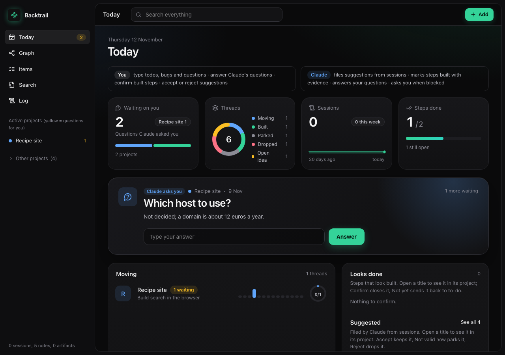

# Backtrail

Backtrail indexes Claude Code sessions and Markdown notes into one SQLite file and shows them in a local web app,
grouped into threads. Decisions, steps and open questions are recorded on each thread, and each one
links to the session or note it came from with the exact quote.

Status: prototype. Tested on macOS only.

## Terms

A thread is one line of work, such as an app, a product idea or a topic. It collects the sessions and notes about that
work, and the decisions, steps and questions filed from them. A thread has a state (for example in development, built,
parked or dropped). The app and the CLI use this one word.

## How it works


- Claude Code keeps one folder per working directory in `~/.claude/projects`. Each folder becomes a thread.
- Sessions and notes are read, never changed.
- Decisions, steps and questions are proposed from sessions. A proposal is rejected if its quote is not found in the
  cited source.
- A proposed decision, rationale or state claim is kept without review when its quote is a turn the owner typed and
  says it directly, unless an earlier fact of the same type on the same thread shares three or more content words with
  it. Everything else (steps, questions, relations, the assistant's words, possible repeats) waits for review in the app.
  A decision kept this way can still be rejected on the Items and thread pages; kept rationale and state claims have
  no reject control in the app yet.
- When a session ends, a hook indexes its new text. Session files are read from where the last read stopped, so stored
  passages keep their ids.


More detail: `docs/architecture.md`.

What it reads and sends:

- Reads: Claude Code sessions and memory notes, plus note folders and git repositories listed in `config.json`.
- Writes: the data directory (database, backups, saved artifacts), and `~/.claude/settings.json` on `bt hooks install`.
- Network: passage and query text go to the local Ollama server. The `claude` CLI scripts in `skill/` send session text
  to Claude.
- Stored text: the database is not encrypted and is readable by its owner only. Access tokens and private keys in
  common formats are replaced with `[redacted secret]` when text is indexed; secrets without a fixed format are stored
  as written.

## Screenshots

| | |
| --- | --- |
|  |  |

## Requirements

- Rust 1.85 or later, and Node.js
- Ollama, for search by meaning. Other embedding servers (such as LM Studio) are not supported.
- The `claude` CLI, for building the graph and proposing decisions and steps

## Install

```
ollama pull embeddinggemma-2:270m
./install.sh
bt serve
```

`install.sh` builds the app and links it as `bt`. `bt serve` starts the app at `http://127.0.0.1:8799` and indexes
existing sessions on first start.

Optional setup:

- Custom threads, note folders and git repositories: `config.json` in the data directory (`docs/reference.md`).
- Moving to another machine: copy the data directory before the first `bt serve`.

Environment variables:

| Variable | Default |
| --- | --- |
| `BACKTRAIL_HOME` | `~/Library/Application Support/Backtrail` |
| `BT_BIN_DIR` | `~/.local/bin` |

## Usage

| Command | Purpose |
| --- | --- |
| `bt serve [--port N]` | Run the app; it rescans every 5 minutes |
| `bt hooks install` | Index each session when it ends and show a brief when one starts (`bt hooks remove` undoes it) |
| `bt search <words>` | Search with cited sources |
| `bt check` | Report lost quotes, orphan threads and stale work |

Other commands: `docs/reference.md`.

## Limits

- Search compares vectors in memory, which suits a few hundred thousand passages at most.
- Search ranking is set by hand. Embedding models compared: `embeddinggemma-2:270m` and `nomic-embed-text`, on 519
  queries from one store (`docs/reference.md`).
- The quote check proves a quote exists in the source, not that the title is a fair reading of it.
- Automatic extraction of decisions, the keep rule and the matching of steps to commits have not been measured for
  accuracy. On one store the keep rule kept 477 of 805 proposed facts and held 42 as possible repeats.
