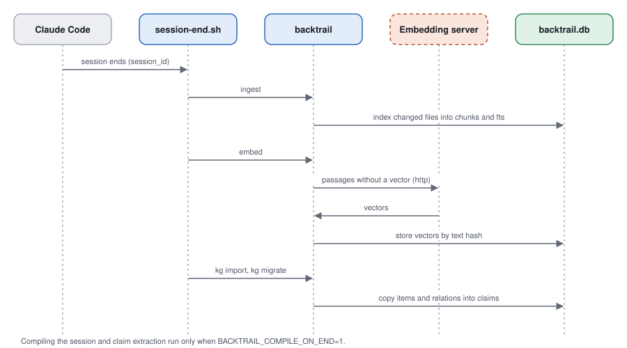
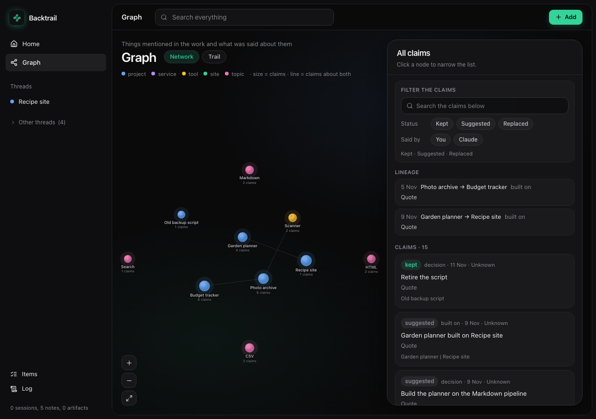
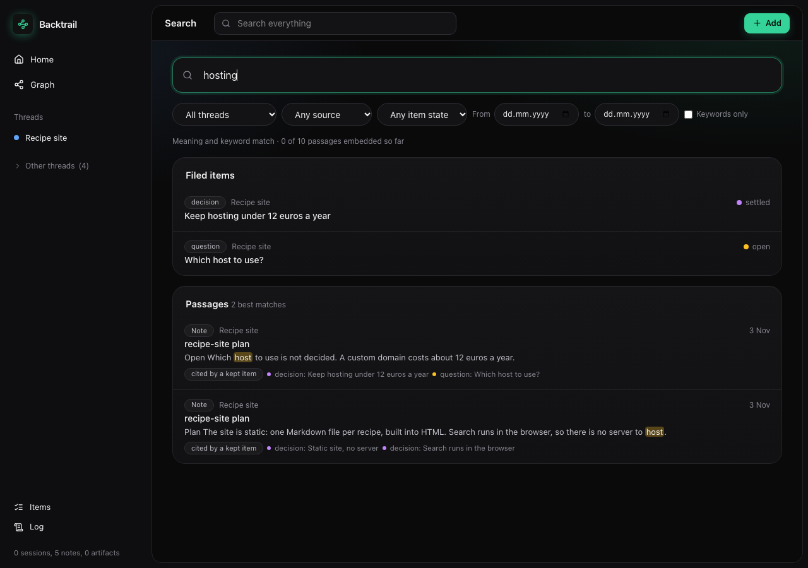

# Backtrail

Backtrail reads Claude Code sessions and Markdown notes into one SQLite file and records the decisions, steps and open
questions in them, grouped into threads. Each recorded item links to the session or note it came from with the exact
quote. A local web app shows the work by project, and a session-start hook prints a brief so that a new session starts
from what was already decided.

Status: prototype. Tested on macOS only.

## Terms

A thread is one line of work, such as an app, a product idea or a topic. It collects the sessions and notes about that
work, and the decisions, steps and questions filed from them. A thread has a state (for example in development, built,
parked or dropped). The app and the CLI use this one word.

A decision is settled when its quote is a turn the owner typed, when the owner accepts it in the app, or when it was
compiled from a note. Any other decision stays proposed.

## How it works


- Claude Code keeps one folder per working directory in `~/.claude/projects`. Each folder becomes a thread.
- Sessions and notes are read, never changed.
- Decisions, steps and questions are proposed from sessions. A proposal is rejected if its quote is not found in the
  cited source.
- A proposed decision, rationale or state claim is kept without review when its quote is a turn the owner typed and
  says it directly, unless an earlier fact of the same type on the same thread shares three or more content words with
  it. Everything else (steps, questions, relations, the assistant's words, possible repeats) waits for review in the app.
  A decision kept this way can still be rejected on the Items and thread pages; kept rationale and state claims have
  no reject control in the app yet.
- Proposed items are not treated as knowledge. The brief lists settled decisions only. Search and `bt kg find` rank
  settled claims above proposed ones and label the state. The project page shows proposed items under "Unconfirmed
  suggestions".
- Each decision in the brief and on the project page shows who confirmed it: `owner-stated` (the keep rule),
  `owner-accepted` (accepted in the app) or `from a note`.
- A replaced decision is retired with a pointer to the newer one (`bt retire <id> --by <id> --reason <text>`). Retired
  decisions leave the brief and the project page; the quote and source stay on file.
- When a session ends, a hook indexes its new text, then extracts proposals from it. Session files are read from where
  the last read stopped, so stored passages keep their ids.



More detail: `docs/architecture.md`.

App screens:

- Home: the last two weeks of work on one timeline, one card per project in motion with its next step and latest
  decisions, and a link to each project that has open questions from Claude.
- Project page: latest decisions, next steps, open questions to answer, and a search limited to the project.
- Graph: entities and the claims about them (network view), and every thread over time (trail view).
- Search, Items, Log and the source reader.

What it reads and sends:

- Reads: Claude Code sessions and memory notes, plus note folders and git repositories listed in `config.json`.
- Writes: the data directory (database, backups, saved artifacts), and `~/.claude/settings.json` on `bt hooks install`.
- Network: passage and query text go to the local Ollama server. The `claude` CLI scripts in `skill/` send session text
  to Claude.
- Stored text: the database is not encrypted and is readable by its owner only. Access tokens and private keys in
  common formats are replaced with `[redacted secret]` when text is indexed; secrets without a fixed format are stored
  as written. Tool output (command results, file contents read by tools) is not stored.

## Screenshots

Demo data, not real projects.

| | |
| --- | --- |
|  |  |
|  |  |

## Comparison with similar tools

Other tools also record Claude Code sessions and make them available to later sessions. As described in third-party
listings and documentation:

- claude-mem compresses session observations with a model, stores them in a local SQLite database and injects recent
  context at session start.
- Longhand indexes tool calls, file edits and thinking blocks for semantic search and replay.
- ccrecall indexes conversations with SQLite full-text search and injects relevant context into later sessions.

None of them was installed or tested for this comparison, so the right-hand column below is only what those
descriptions say.

| | Backtrail | Session-memory tools, per their documentation |
| --- | --- | --- |
| Stored | Decisions, steps and questions, each with a verbatim quote and a link to its source; passages of user and assistant text | Model-written observations (claude-mem), or indexed session content (Longhand, ccrecall) |
| Tool output (edits, commands) | Not stored | Stored by some |
| Trust | A claim is rejected when its quote is not found in the source. Settled from owner-typed text, an in-app accept or a note. Unconfirmed items rank below settled ones and stay out of the brief | Not described in the documentation consulted |
| Replaced decisions | Retired with a pointer to the newer decision; left out of the brief | Not described in the documentation consulted |
| Sources | Sessions, Markdown notes, published pages, git commits | Sessions |
| Human-readable view | Local web app: project pages, timeline, graph | Varies |
| Setup | macOS, Rust toolchain, local Ollama server, `claude` CLI | Varies: plugin, MCP server or CLI |
| Maturity | Prototype, tested on one machine | Not assessed; one listing gives claude-mem a large GitHub star count |

Another tool fits better when the need is a record of what the agent did (edits, commands, replay), support for several
coding agents, or setup without a Rust toolchain and a local embedding server.

What is not shown yet: that the settled decisions are still true. A sample of 50 decisions found 48 supported by their
quote, which tests the quote and not whether a decision was later reversed. Replacing a reversed decision is manual.

## Requirements

- Rust 1.85 or later, and Node.js
- Ollama, for search by meaning. Other embedding servers (such as LM Studio) are not supported.
- The `claude` CLI, for building the graph and proposing decisions and steps

## Install

```
ollama pull embeddinggemma-2:270m
./install.sh
bt serve
```

`install.sh` builds the app and links it as `bt`. `bt serve` starts the app at `http://127.0.0.1:8799` and indexes
existing sessions on first start.

Optional setup:

- Custom threads, note folders and git repositories: `config.json` in the data directory (`docs/reference.md`).
- Moving to another machine: copy the data directory before the first `bt serve`.

Environment variables:

| Variable | Default |
| --- | --- |
| `BACKTRAIL_HOME` | `~/Library/Application Support/Backtrail` |
| `BT_BIN_DIR` | `~/.local/bin` |

## Usage

| Command | Purpose |
| --- | --- |
| `bt serve [--port N]` | Run the app; it rescans every 5 minutes |
| `bt hooks install` | Index each session when it ends and show a brief when one starts (`bt hooks remove` undoes it) |
| `bt brief [--thread T]` | Print the brief: one line per project in motion, or with `--thread` its questions, next step and latest settled decisions |
| `bt search <words>` | Search with cited sources |
| `bt kg find "<question>"` | Answer a history question from claims (settled ones first), falling back to passages |
| `bt retire <id> [--by <id>] --reason <text>` | Retire a decision that was replaced or never was one |
| `bt check` | Report lost quotes, orphan threads and stale work |

Other commands: `docs/reference.md`.

## Limits

- Search compares vectors in memory, which suits a few hundred thousand passages at most.
- Search ranking is set by hand. Embedding models compared: `embeddinggemma-2:270m` and `nomic-embed-text`, on 519
  queries from one store (`docs/reference.md`).
- The quote check proves a quote exists in the source, not that the title is a fair reading of it.
- A settled decision stays settled until it is retired by hand. The resolver compares only proposed items with
  existing ones, so a later decision that reverses an earlier settled one is not detected.
- A hedged statement ("seems", "probably") can be stored as a decision.
- A decision's thread comes from the session it was made in, and its entity tags from extraction. On one store, 61 of
  371 settled decisions with a project entity had an entity outside their thread; in a sample of 15 of them, one
  rater judged the thread right in about two thirds.
- Automatic extraction of decisions, the keep rule and the matching of steps to commits have not been measured for
  accuracy. On one store the keep rule kept 477 of 805 proposed facts and held 42 as possible repeats.
