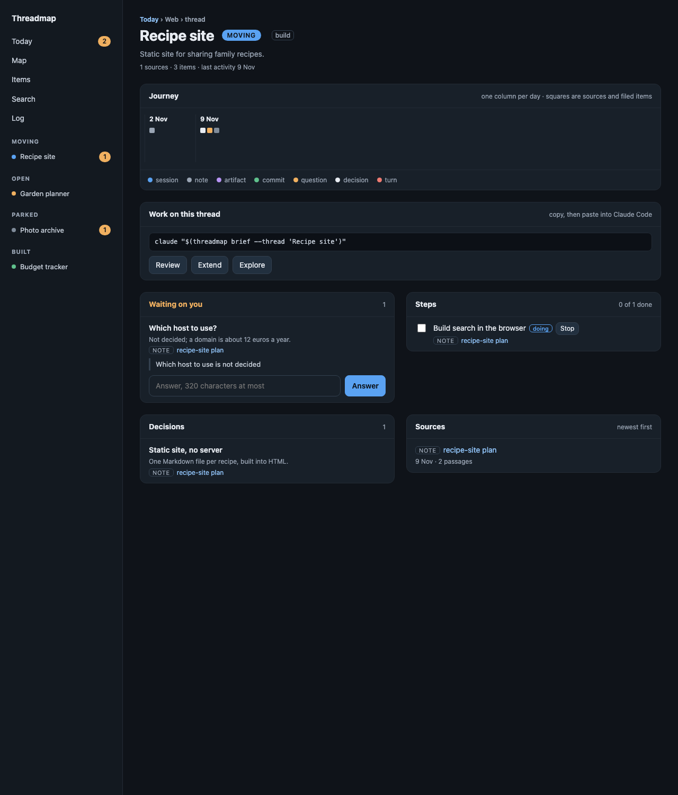

# Backtrail

Backtrail keeps the trail of work done with coding agents: Claude Code, Gemini CLI and Codex CLI, plus hooks and
reading for Antigravity, whose sessions need a converter. Sessions and notes are archived in one SQLite file, and the decisions, steps and open questions in them are filed by
project, each with the line it came from. The agent reads the trail when a session starts; a web app and a Mac app
show it by project, over time and as a graph.

| | |
| --- | --- |
|  |  |

## How it works


- Each connected agent's sessions are indexed. A session is read for decisions when it ends, or by the sweep every
  5 minutes; `bt status` shows each session's state. Each item is filed with a verbatim quote, checked against the
  source.
- Each prompt is matched against settled decisions; up to two that bear on it are added to the agent's context.
- A decision is settled when the user typed it, accepts it in an app, or it comes from a note. A step closes when a
  session shows it finished and a second model agrees.
- Unconfirmed items are parked after 14 days, or when their project is built, dropped or parked.
- Things the work mentions (projects, tools, models) form a graph across projects.

Detail: [`docs/architecture.md`](docs/architecture.md). Per-agent support: [`docs/harnesses.md`](docs/harnesses.md).

## Requirements

- Rust 1.85+ and Node.js to build.
- One coding agent CLI to read sessions: `claude`, `gemini`, `codex` or `agy`, or any command with a headless mode.
- Optional: Ollama (`embeddinggemma-2:270m`) for search by meaning; Swift (Xcode command line tools) for the Mac app.

## Install

```
./install.sh
bt build
```

`install.sh` asks which agents to connect, offering the ones on `PATH`, and sets up hooks and the skill for those
only. On macOS it also installs a login agent that runs the server and builds the Mac app; elsewhere, run `bt serve`.
Options and first-run notes: [`docs/reference.md`](docs/reference.md).

## Usage

- `bt build` offers to read the newest 20 sessions, so the brief has content on day one.
- Web app: `http://127.0.0.1:8799`. Mac app: `mac/Backtrail.app`.
- `bt search <words>` searches with cited sources; `bt brief` prints what was decided and what is next.
- `bt hooks install --harness <agent>` and `bt agent <agent>` change the connected agents later.

## Data

- Reads: Claude Code, Codex CLI and Gemini CLI session folders when present, inbox session files, and the note
  folders and git repositories in `config.json`.
- Writes: the data directory (database, backups, logs), each connected agent's hooks file and skill link, and the
  login agent on macOS.
- Sends: session text to the reading agent's CLI, about 6 model calls per session read, counted against that CLI's
  plan or API key. Passage text goes to the embedding server (`127.0.0.1:11434`).

## Limits

- Gemini CLI, Codex CLI and Antigravity support follows their docs and source and has not run against the real tools.
  Antigravity sessions need a converter ([`docs/harnesses.md`](docs/harnesses.md#adding-a-tool)).
- Search holds vectors in memory: a few hundred thousand passages at most.
- The quote check shows a quote exists, not that the title reads it fairly.
- An item's project can be wrong. `bt check` reports items moved or retired by hand in the last 7 days.

## License

MIT. See [`LICENSE`](LICENSE).
