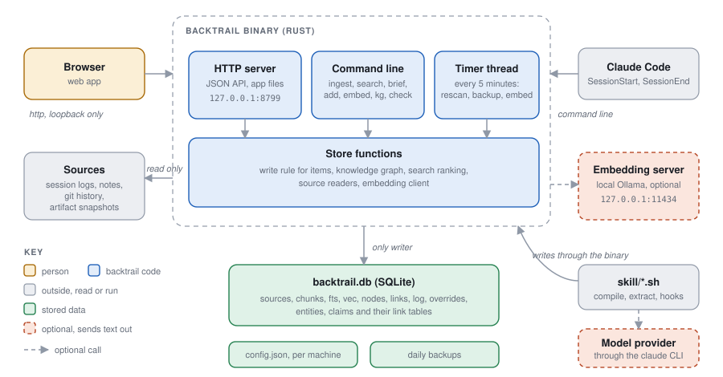

# Backtrail

Backtrail reads sessions and notes from coding agents. It files decisions, open steps, questions, reasons, facts about
how something is, and relations as claims. Each claim keeps the exact line it came from and names the projects, tools or models it is about.

## Problem

Coding agents make it easy to start more projects than one person can follow.

- Each agent keeps its own transcripts. Notes live in other files.
- A project left alone for a couple of weeks takes time to pick up again.
- Search returns matches, not what was decided, why, or what it replaced.

Backtrail keeps what was decided, what is still open, and where each claim came from. A session starts with that
brief. The web and Mac apps show the same trail per project, over time.

| | |
| --- | --- |
|  |  |

## How it works



- Each agent's sessions are indexed. A session is read when it ends, or by the sweep every 5 minutes. `bt status` shows
  each session's state.
- Each item keeps the exact line it came from. The line is checked against the source.
- Each prompt is checked against settled decisions. Up to two that fit are added to the agent's context.
- A decision is settled when the user says it, accepts it in an app, or a note says it. A step closes when a session
  shows it finished and a second model agrees. The proof also names each PR opened in that session and its GitHub state.
- Unconfirmed items are parked after 14 days, or when their project is built, dropped or parked.
- Projects, tools and models are entities. Claims point at them. The graph traces a decision back to its reason and
  shows the projects connected through the same entities.

Detail: [`docs/architecture.md`](docs/architecture.md). Per-agent support: [`docs/harnesses.md`](docs/harnesses.md).

## Requirements

- Rust 1.88+ and Node.js 22+ to build.
- One coding agent CLI to read sessions: `claude`, `gemini`, `codex` or `agy`, or any command with a headless mode.
- Optional: Ollama (`embeddinggemma-2:270m`) for semantic search; without it, search is keyword only. Swift (Xcode
  command line tools) for the Mac app.

## Install

```
./install.sh
bt build
```

`install.sh` asks which agents to connect, offering the ones on `PATH`. It sets up hooks and the skill for those
agents only. On macOS it also installs a login agent that runs the server and builds the Mac app. Elsewhere, run
`bt serve`. Options and first-run notes: [`docs/reference.md`](docs/reference.md).

## Usage

- `bt build` offers to read the newest 20 sessions, so the brief has content on day one.
- Web app: `http://127.0.0.1:8799`. Mac app: `mac/Backtrail.app`.
- `bt search <words>` searches with cited sources.
- `bt brief` prints what was decided and what is next.
- `bt hooks install --harness <agent>` and `bt agent <agent>` change the connected agents later.

## Data

- Reads: Claude Code, Codex CLI and Gemini CLI session folders, inbox files, and the notes and git repos in
  `config.json`.
- Writes: the data directory (database, backups, logs), agent hooks and skill links, and the macOS login agent.
- Sends: repo names to GitHub through `gh pr list`, to read each linked PR's state (`bt prs`, hourly in the sweep).
- Sends: session text to the reading agent's CLI, about 6 model calls per session. Passage text goes to the embedding
  server (`127.0.0.1:11434`). Calls count against that CLI's plan or API key.

## Limits

- Gemini CLI, Codex CLI and Antigravity support follows their docs, not real runs. Antigravity sessions need a
  converter ([`docs/harnesses.md`](docs/harnesses.md#adding-a-tool)).
- Semantic search scans every stored vector. At 190,000 passages it takes about 0.3 s per search, with flat memory.
- The quote check only shows the quote exists. It does not show the title reads it fairly.
- Pushes straight to `main` with no PR are not tracked as landed.
- An item can land in the wrong project. `bt check` lists items moved or retired by hand in the last 7 days.

## License

MIT
