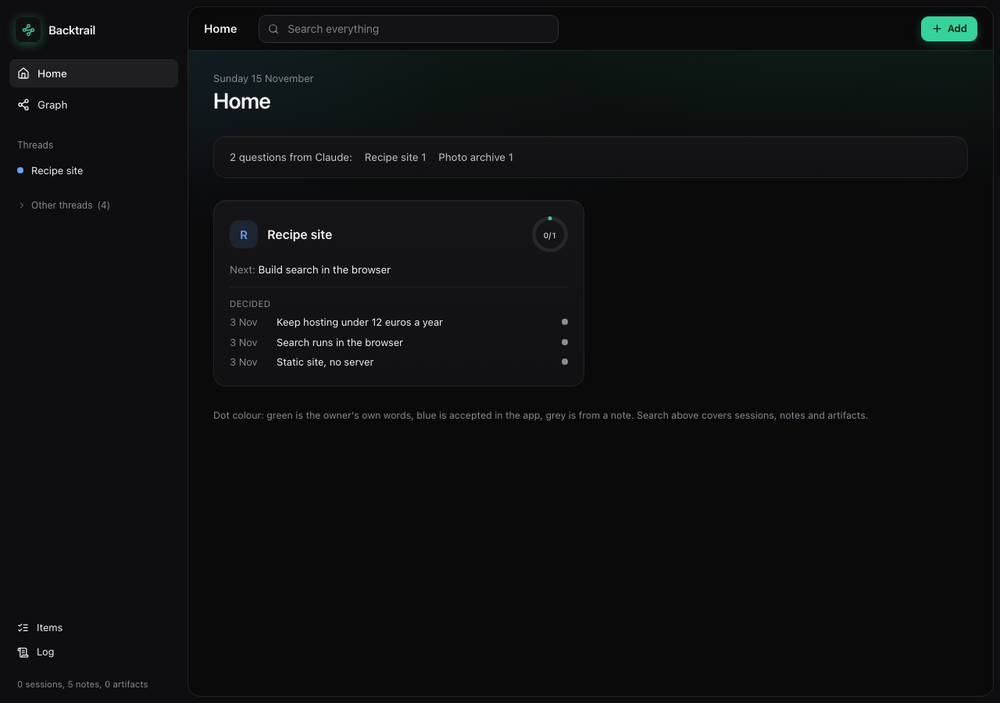

# Backtrail

Backtrail reads Claude Code sessions and Markdown notes into one SQLite file and records the decisions, steps and
questions in them. Each record links to its source with the exact quote. A local web app shows the work by project, and
a session-start hook prints a brief of what was already decided.

Status: prototype. Tested on macOS only.

## How it works


- Each Claude Code working directory becomes a thread, one line of work. Sessions and notes are read, never changed.
- Decisions, steps and questions are proposed from sessions. A proposal is rejected when its quote is not in the cited
  source.
- A decision is settled when its quote is a turn the owner typed, when the owner accepts it in the app, or when it
  comes from a note. Anything else stays proposed.
- Proposed items stay out of the brief and rank below settled ones in search. The brief and the project page show who
  confirmed each decision.
- A replaced decision is retired with `bt retire`, or marked superseded by the opt-in `resolve.sh --reverses`.
- Claude's proposals and open questions that are still unconfirmed 14 days after their session are parked: kept on file, listed nowhere. The brief hands open questions to Claude to ask in the session; the reply is recorded with `bt answer`.
- On session end: ingest, embed, extract, resolve. Every 5 minutes: rescan, embed, back up. The binary calls no model;
  the model passes are scripts in `skill/`.

Detail: `docs/architecture.md`, `docs/reference.md`.

Reads: Claude Code sessions, note folders and git repositories from `config.json`. Writes: the data directory and, on
`bt hooks install`, `~/.claude/settings.json`. Network: text goes to a local Ollama server, and the `claude` CLI
scripts in `skill/` send session text to Claude. The database is not encrypted; common token formats are redacted.
Tool output is not stored.

| | |
| --- | --- |
|  |  |

Demo data.

## Install

Requires Rust 1.85+, Node.js, Ollama (`ollama pull embeddinggemma-2:270m`) and the `claude` CLI.

```
./install.sh
bt serve
```

`install.sh` builds the app and links it as `bt`. `bt serve` starts the app at `http://127.0.0.1:8799`.
`BACKTRAIL_HOME` sets the data directory (default `~/Library/Application Support/Backtrail`).

## Usage

| Command | Purpose |
| --- | --- |
| `bt hooks install` | Index each session when it ends and print a brief when one starts |
| `bt brief [--thread T]` | Print the brief, or one project's questions, next step and latest decisions |
| `bt search <words>` | Search with cited sources |
| `bt kg find "<question>"` | Answer a history question, settled claims first |
| `bt kg neighbors <entity> [--depth N]`, `kg path <A> <B>`, `kg export --graph <file>` | Entities within N links, the shortest chain between two, a GraphML or JSON export. `--as-of YYYY-MM-DD` limits `find`, `page`, `trace`, `neighbors` and `path` to the claims in force that day |
| `bt retire <id> [--by <id>] --reason <text>` | Retire a replaced decision |
| `bt answer <id> --text <text>` | Record the owner's reply to an open question |

Other commands: `docs/reference.md`.

## Limits

- Search compares vectors in memory: a few hundred thousand passages at most.
- The quote check shows the quote exists, not that the title reads it fairly.
- A settled decision stays until retired. `resolve.sh --reverses` caught 2 of 4 changes of mind and 1 of 7
  stopped-project cases in one test, with no false reversal among 20 other decisions.
- Hedged statements can be stored as decisions, and a decision's thread can be wrong.
- Extraction and keep-rule accuracy are not measured.
