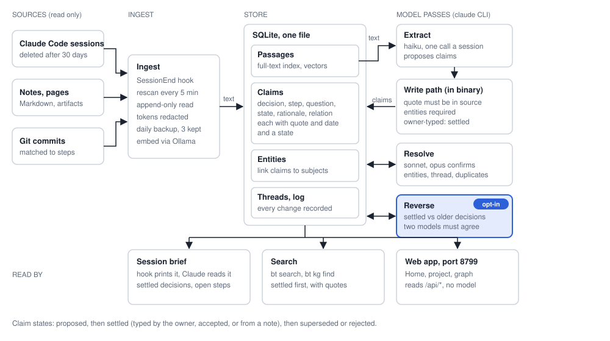

# Backtrail

Backtrail reads Claude Code sessions and Markdown notes into one SQLite file and records the decisions, steps and
questions in them. Each record links to its source with the exact quote. A local web app shows the work by project, and
a session-start hook prints a brief of what was already decided.

| | |
| --- | --- |
|  |  |

## How it works



- Each working directory becomes a thread. Sessions and notes are read, never changed.
- Decisions, steps and questions are proposed from sessions. A proposal is rejected when its quote is not in the source.
- A decision is settled when the owner typed it, accepts it in the app, or it comes from a note. Otherwise it stays proposed.
- Unconfirmed proposals and open questions are parked after 14 days.
- The binary calls no model. The model passes are scripts in `skill/`.

Detail: `docs/architecture.md`, `docs/reference.md`.

## Install

Requires Rust 1.85+, Node.js, Ollama (`ollama pull embeddinggemma-2:270m`) and the `claude` CLI.

```
./install.sh
bt serve
```

`bt serve` starts the app at `http://127.0.0.1:8799`. `BACKTRAIL_HOME` sets the data directory (default
`~/Library/Application Support/Backtrail` on macOS, `~/.local/share/backtrail` elsewhere).

## Usage

```
bt hooks install     # index each session at its end, print a brief at its start
bt search <words>    # search with cited sources
```

Claude runs the other commands (`brief`, `answer`, `retire`, `kg`) from the hook and `skill/SKILL.md`. List:
`docs/reference.md`.

## Data

Reads Claude Code sessions, note folders and git repositories from `config.json`. Writes the data directory and, on
`bt hooks install`, `~/.claude/settings.json`. Text goes to a local Ollama server; the `claude` CLI scripts in `skill/`
send session text to Claude. The database is not encrypted; common token formats are redacted.

## Limits

- Search compares vectors in memory: a few hundred thousand passages at most.
- The quote check shows the quote exists, not that the title reads it fairly.
- Hedged statements can be stored as decisions, and a decision's thread can be wrong.
- Extraction accuracy is not measured.
