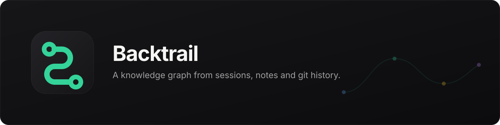

# Backtrail



Backtrail builds a knowledge graph from coding-agent sessions, notes and git history. It holds decisions, steps,
questions and facts, each referencing the session that stated it. Decisions link to the projects, tools and models they
are about, to the reasons behind them and to the decisions they replace. Agents propose claims; a decision is settled
when the user states it in a session, accepts it in an app or writes it in a note.

Agents read the graph through hooks. A session starts with the open steps of the projects in motion, and each prompt
receives the settled decisions that bear on it. The web and Mac apps show the graph, the trail and the decisions per
project, over time.

## Problem

Coding agents make it easy to work on many projects in parallel, and faster.

- Each agent keeps its own transcripts. Notes live in other files.
- A project left alone for a couple of weeks takes time to pick up again.
- Search returns matches, not what was decided, why, or what it replaced. Reading notes or session history instead is
  more than one person can follow across many long-running projects.
- A new session does not know what earlier sessions settled, so the agent asks again or undoes it.

| | |
| --- | --- |
|  |  |

## How it works

1. When a session ends, Backtrail indexes it and a model reads it. The model proposes decisions,
   steps and questions, each with the line it came from; a claim whose line is not in the session is refused.
2. A model links each new claim to earlier ones: repeats, answers to open questions, and decisions it reverses. A
   second model call must confirm each reversal.
3. The user settles decisions. Claims nobody confirms are parked after 14 days.
4. A step is marked done when a model finds it finished in a session and a second model call confirms it. The proof
   names that session's pull requests and pushes to `main`, with their state on GitHub.
5. The next session starts with the open steps of the projects in motion, and each prompt gets up to two settled
   decisions that match it.


Detail: [`docs/architecture.md`](docs/architecture.md). Per-agent setup: [`docs/harnesses.md`](docs/harnesses.md).

## Requirements

- Rust 1.88+ and Node.js 22+ to build.
- A coding agent CLI for the model that reads sessions: `claude`, `gemini` or `codex`
- gh
- Ollama with `embeddinggemma-2:270m`, embeddings for semantic search
- Swift, for the Mac app

## Install

```
./install.sh
bt build
```

`install.sh` asks which agents to connect, adds Backtrail's hooks and skill to each, and on macOS installs a LaunchAgent that runs the server and builds the Mac app. Elsewhere, run `bt serve`. More:
[`docs/reference.md`](docs/reference.md).

## Usage

- Web app at `http://127.0.0.1:8799`, Mac app at `mac/Backtrail.app`.
- `bt build` indexes all sessions and notes. The server then has the model read them in the background, and the brief
  fills as it does.
- `bt search <words>` searches with sources. `bt brief` prints what was decided and what is next.
- `bt hooks install --harness <agent>` connects another agent. `bt agent <agent>` changes which CLI reads sessions.

## Data

- Reads the session folders of Claude Code, Codex CLI and Gemini CLI, an inbox folder for other tools, and the notes
  folders and git repos listed in `config.json`.
- Writes the data directory (database, backups, logs), the hooks and skill of each connected agent, and on macOS a
  LaunchAgent.

## Limits

- Gemini CLI, Codex CLI and Antigravity support follows their documentation and has not been run on real sessions. Antigravity sessions need a converter ([`docs/harnesses.md`](docs/harnesses.md#adding-a-tool)).
- The quote check confirms the quoted line exists, not that the claim's title reads it correctly.

## License

MIT
